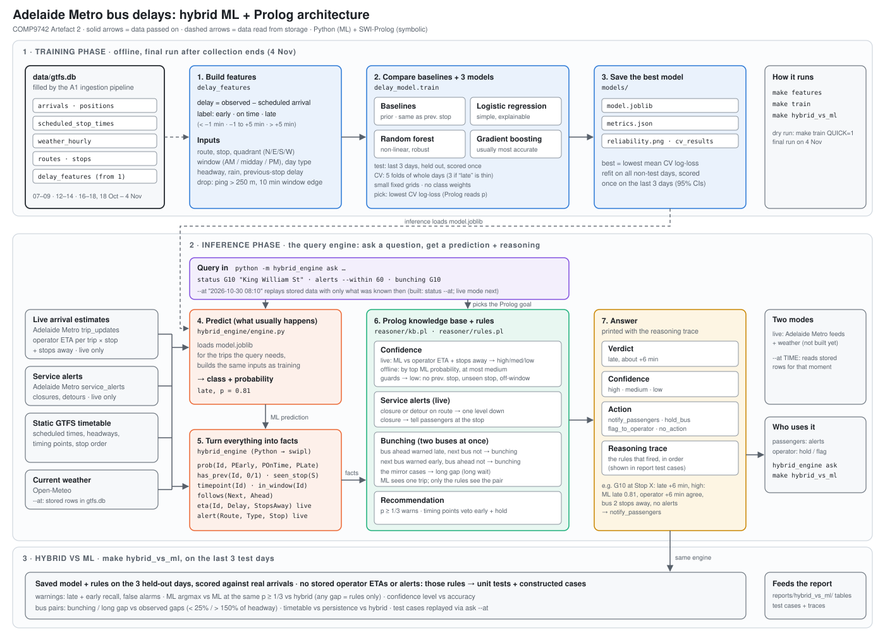

# A2: Hybrid ML + Prolog architecture

COMP9742 Artefact 2. The system predicts whether a bus will be early, on time or late at a chosen Adelaide CBD stop.
It then reasons about how far to trust that prediction and what to do about it.



## The idea in one paragraph

- **The ML model knows what usually happens.** From 12 days of past positions and weather, it learns how late this route tends to be at this stop, in this window, in this weather.
- **Adelaide Metro's live feed knows what is happening now.** It gives the operator's own arrival estimate for this particular bus, and how many stops away the bus is.
- **Prolog decides between the two.** It uses facts the model cannot see: the timetable, service alerts and the bus behind. The result is a delay verdict, a confidence level, an action, and the list of rules that led there.

## Inputs

| Source | What it gives | When |
|---|---|---|
| `data/gtfs.db` (A1 pipeline) | observed vs scheduled arrivals, timetable of the chosen stops, hourly precipitation, chosen routes and stops | training |
| Adelaide Metro `trip_updates` | operator's arrival estimate per trip × stop, and stops away | live only (not stored) |
| Adelaide Metro `service_alerts` | stop closures, detours, timetable changes per route | live |
| Static GTFS timetable | scheduled times, headways, timing points, stop order | both |
| Open-Meteo | current weather | live |

Collection: 3 windows a day (07–09, 12–14, 16–18), 18 Oct – 4 Nov 2026. Freeze the data on the morning of 4 Nov; the deadline is 5 Nov 16:30.

## 1. Training phase (offline, final run after collection ends)

Dry-run daily on partial data so the pipeline is proven before the final run on 4 Nov.

1. **Build features** (`delay_features`, `make features`): one row per observed arrival (trip × stop × service date).
   - Delay = observed − scheduled arrival.
   - **Target:** label each arrival **early** (more than 1 min early), **on time** (1 min early to 5 min late) or **late** (more than 5 min late).
     Bands of at least a minute match the accuracy of our observed arrival (15 s polling, closest ping within 500 m).
   - **Quality filter:** drop arrivals whose closest ping is further than `MAX_ARRIVAL_PING_M` from the stop; their observed time is too uncertain for the bands.
     Ping distance measures the label's accuracy, not the bus, and is unknown before arrival, so it is a filter, not an input.
   - **Edge filter:** drop arrivals scheduled within `EDGE_MARGIN_MINUTES` (10) of a window's start or end; a late or early bus there can fall outside the window and never be seen, which would bias the classes.
   - Every choice and drop rule is logged in `docs/A2_FEATURE_DECISIONS.md`.
   - **Inputs (8):** route, stop, quadrant, window (AM / midday / PM: the collection window the scheduled time falls in), day type (weekday / weekend), scheduled headway, the same trip's delay at its previous chosen stop (0 plus a "no previous stop" flag at the first one), and precipitation in the scheduled hour.
     Precipitation is the only weather input: it has a clear effect (slower traffic, longer boarding), and with about 12 days, more weather columns would mostly identify the day.
2. **Train and compare the models** (`delay_model`, `make train`; `QUICK=1` for a dry run).
   - **Baselines:** most common class; "same class as the previous stop" as a rule, and as a logistic regression on that delay alone (`persistence_lr`), so it has probabilities too.
     Delays carry forward, so the persistence baseline is the bar that matters: every model is reported as its gain over it.
   - **Tuned models**, each justified by the data:
     logistic regression (the main signal, previous-stop delay, is close to linear, and its coefficients can be read),
     random forest (route × stop × window interactions on small data, little tuning),
     gradient boosting (`HistGradientBoostingClassifier`; threshold effects on mixed inputs, the accuracy end).
   - **Test set:** the last `TEST_DAYS` (3) service dates, held out and scored once.
     Whole days, because buses on the same day share weather and incidents; a split inside a day would leak them.
   - **CV:** `StratifiedGroupKFold`, grouped by date, stratified by class, on the remaining days: 5 folds, or 3 if a fold would hold fewer than 5 late rows.
   - **Small fixed grids** (`GridSearchCV`, about 32 settings in all); with about 13 independent days, a bigger search only fits noise.
   - **No class weights.** Prolog reads the probabilities, and weights would inflate p(late) on purpose. Caution about late buses lives in Prolog's confidence rules instead.
3. **Save the best model** (`models/model.joblib`), with `metrics.json`, `cv_results.csv`, LR coefficients, gradient boosting permutation importance and a reliability plot.
   - Best = lowest mean CV **log-loss**, because the output Prolog uses is a probability. Brier, macro-F1 and late recall are reported next to it.
   - Sigmoid calibration is kept only if it lowers the winner's CV log-loss.
   - The winner is refit on all non-test days, then scored once on the test days, with 95% bootstrap intervals (whole trips resampled) and results split by first stop vs later stops.

The operator's estimate is **not** an ML input. If it were, the "ML vs operator" check in Prolog would be comparing a source with itself.

## 2. Inference phase: the query engine (`hybrid_engine`)

Once training is done, the system is used by **asking it a question**.
It fetches the data for that moment, predicts, reasons, and answers with its reasoning trace.

```
$ python -m hybrid_engine ask status G10 "King William St"

Next G10 at King William St (trip 1029412), due 08:14
Verdict: late, about +6 min  ·  Confidence: HIGH  ·  Action: notify_passengers
Why:
  - ML predicts late (p = 0.81)
  - Adelaide Metro estimate +6 min, agrees with ML
  - bus is 2 stops away → live estimate trusted
  - no active alerts on G10
```

### Queries

| Query | Asks | Prolog goal |
|---|---|---|
| `status <route> <stop>` | When will the next bus(es) really arrive, and how sure are we? | `answer(status(Route, Stop), Answer, Trace)` |
| `alerts [--within 60]` | Which chosen stops need a passenger alert in the next N minutes? | `answer(alerts(Minutes), Answer, Trace)` |
| `bunching <route>` | Are buses on this route about to bunch, or is there a long gap? | `answer(bunching(Route), Answer, Trace)` |

Every query takes **`--at "2026-10-30 08:10"`** to answer for a past moment from stored data instead of live feeds.
The engine is the same either way. Only `status` with `--at` is built so far; live mode and the `alerts` and `bunching` queries are next.
`--at` is used for:
- the demo video, which then does not depend on buses running while recording;
- the report's test cases, which can be reproduced exactly;
- the evaluation on the test days.

### What happens for one query

1. **Read the query:** question type, route, stop, time (now, or `--at`).
2. **Get that moment's data:**
   - live (default): Adelaide Metro `trip_updates` and `service_alerts`, plus current weather from Open-Meteo;
   - `--at`: the stored `delay_features` rows of buses due within 60 min that had not reached the stop by that time.
     Only what was known then is used: a previous-stop delay counts only if that stop was passed by `--at`, and the arrival itself is never shown to the rules.
     Operator estimates and alerts were never stored, so a replay always takes the "no operator estimate" row below.

   Only the trips the question needs are kept: chosen-route trips whose upcoming stops include the asked stop(s), with stops away.
3. **Build inputs** for those trips with the same feature code as training, so live inputs match training inputs.
4. **Predict:** load `model.joblib` and get class + probability per trip × stop, e.g. `late, p = 0.81`.
5. **Turn everything into facts.** Python writes this query's facts next to the static knowledge base and calls SWI-Prolog:
   ```prolog
   ml_class(Trip, Stop, Class, P).          % ML prediction
   eta(Trip, Stop, Time, StopsAway).        % operator's estimate (live only)
   scheduled(Trip, Stop, Time).             % timetable
   headway(Route, Stop, Window, Minutes).   % timetable
   alert(Route, Type, Stop).                % service alerts (live only)
   follows(TripB, TripA, Stop).             % B is the next bus after A
   ```
6. **Reason:** run the query's Prolog goal (`reasoner/kb.pl`, `reasoner/rules.pl`) with these rules:

   **Confidence**

   | ML vs operator | Stops away | Confidence | Verdict uses |
   |---|---|---|---|
   | agree | 3 or fewer | high | operator time |
   | agree | more than 3 | medium | operator time |
   | disagree | 3 or fewer | medium | operator time (close, so live data wins) |
   | disagree | more than 3 | low | range between the two |
   | no operator estimate | — | low or medium, by ML probability | ML class |

   **Service alerts:** a closure or detour on the route lowers confidence one level. A closure tells passengers at the stop (suggesting the nearest open stop is future work).

   **Bunching:** see below.

   **Recommendation:** pick one of `notify_passengers`, `hold_bus`, `flag_to_operator` or `no_action`, and record the rules that fired.
7. **Answer:** print the verdict, confidence, action and reasoning trace.

The rules as built (`reasoner/rules.pl`, thresholds in `shared/config.py`, fixed before the test days were seen):
- **Warnings:** warn late (or early) when its probability is at least `P_WARN` (1/3, better than chance over 3 classes), even if it is not the top class. An early warning is vetoed at a timing point, where the bus waits for its scheduled time.
- **Guards:** no previous stop, a stop the model never trained on, or a time outside the collection windows caps confidence at low.
- **Bus pairs:** bunching and long gaps from the two buses' warnings, as described below. Holding a bus is vetoed unless the stop is a timing point.
- Code: `hybrid_engine/` (facts, Prolog bridge, `ask`), tested by `reasoner/test_rules.pl` (plunit) and `tests/test_hybrid_engine.py`.

### When something is missing

- A feed fetch fails, or Adelaide Metro has no estimate for a trip: Prolog falls back to ML only, with low or medium confidence, and the trace says so.
- No chosen bus is due: the answer says so, instead of guessing.
- Prolog error: the query fails with a clear message. Nothing is half-answered.

## How bunching works

Bunching is about two buses at once. The ML model predicts one trip at a time, so it cannot see bunching. Only the rules see the pair of buses.

- **Bunching:** if the predicted gap between a bus and the one behind it is under 25% of the scheduled headway (e.g. G10 every 15 min, buses predicted 2 min apart), raise a bunching alert.
- **Early warning:** this is where the ML adds value. Far from the stop, the operator's estimates do not yet show the gap shrinking. If the leading bus is predicted late and the one behind on time, the gap will close, so Prolog warns before the live times show it.
- **Long gap:** if the gap is over 150% of the headway, passengers face a long wait.
- **Actions:** for bunching, hold the following bus at the next timing point (`timepoint = 1` in the timetable) or tell passengers the next bus is right behind. For a long gap, tell passengers to expect a long wait.
- **Caveat:** bunching only happens on frequent routes, so focus the analysis on the one or two busiest chosen routes.

## 3. Hybrid vs ML alone (`make hybrid_vs_ml`, after `make train`)

**Limitation, stated first in the report:** Adelaide Metro's estimates and alerts were never stored, so every offline answer takes the "no operator estimate" branch.
The operator and alert rules are checked by the plunit tests and the constructed cases only, and shown in one live recording labelled as unscored.

`make hybrid_vs_ml` runs the saved model and the rules over the same last 3 test days as `make train`, scores against the real arrivals, and writes to `reports/hybrid_vs_ml/`:

| Output | What it answers |
|---|---|
| `safety.csv` | Recall and false-alarm rate of late **and early** warnings (an early bus strands passengers too), with 95% intervals, for ML argmax, ML with the same `P_WARN` threshold, and the hybrid. Comparing with the same threshold means any gap comes from the rules, not from lowering a cut-off. If there is no gap, the report says so: the value is then the trace and the guards. |
| `confidence.csv` | Accuracy and coverage per confidence level, for the rules and for the ML probability alone. The difference is what the guards add. |
| `bunching.csv`, `pairs.csv` | Bunching and long gaps between consecutive buses, against the observed gap (under 25% or over 150% of headway), for the timetable (never flags), a persistence pair (the same rule on previous-stop classes) and the hybrid. Only pairs whose warning existed before the leader arrived count. Below 10 real events, only counts and cases are reported. |
| `cases/` | The report's test cases as markdown + JSON: input, ML probabilities, answer, trace, and what really happened. Real cases are picked automatically (confident-correct, confident-wrong, near tie, missing previous stop, heaviest rain, missed early, a case where the rules make it worse, a bunching pair) and replayed through the same path as `ask --at`. Constructed cases, labelled as such, cover what the data cannot: an unseen stop, a time outside the windows, and an operator estimate that disagrees far from the stop plus a closure alert. |
| `metrics.json` | A summary of the above, plus vetoes and guard counts. |

ML model metrics are not repeated here: they are in `models/metrics.json` from `make train`.
Precipitation in a replay is the observed hour; a live query would use a forecast, so offline results are slightly optimistic.

## Commands (planned)

| Command | Does |
|---|---|
| `make features` | build the training table from `gtfs.db` |
| `make train` | compare baselines and 3 tuned models, save the best and the report tables |
| `python -m hybrid_engine ask status <route> <stop> --at TIME` | answer one question with prediction + reasoning (live mode not built yet) |
| `make hybrid_vs_ml` | score what the rules add on the test days; write tables and test cases to `reports/hybrid_vs_ml/` |
